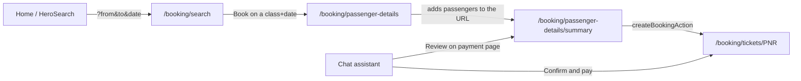

# 04 - Pages and booking flow

## Booking, step by step

1. **Home** (`app/page.tsx`). `HeroSearch` is a client component. It holds the stations, the date and a
   quota tab, then pushes `/booking/search?from=MMCT&to=NDLS&date=2026-10-30&quota=GN`.
2. **Search** (server). It calls `searchTrains(from, to, date)`. `loading.tsx` shows skeletons. Each
   result is a `TrainSeatCard` (client). Clicking a class shows three days of availability, each with a
   "Book" link to passenger details.
3. **Passenger details**. `page.tsx` uses `resolveTrip()` (`passenger-details/trip.ts`) to validate the
   URL and look up the train, then renders `PassengerForm`. Saved passengers from `CURRENT_USER` are one-tap
   chips, and new passengers open a modal. "Proceed to Pay" adds each passenger to the URL as
   `p=name|age|gender|berth` (`booking/passengers.ts`).
4. **Summary**. The server resolves the trip again and parses the passengers. `SummaryForm` shows the fare
   (coupon `RAIL50` takes Rs 50 off) and payment options. "Pay" calls `createBookingAction`. It runs
   `createBooking()`, gets the PNR back and redirects to the ticket.
5. **Ticket** (`/booking/tickets/[pnr]`). This shows passenger status, fare details (`FareDetails.tsx`,
   client) and quick actions linking to live status and the schedule.

The booking status comes from availability. AVL gives a confirmed coach and seat, RAC gives an RAC number
and WL gives a waitlist number.

## Other pages

| Page | What it shows |
| --- | --- |
| `/booking/trips` | All bookings split by `isUpcoming()`. Tabs are client-side, cards are rendered on the server |
| `/pnr` | 10-digit PNR input with sample PNRs |
| `/pnr/[n]` | Train, passenger status table, return-ticket link, confirmation legend. Unknown PNRs list the sample PNRs |
| `/train/running-status/[n]` | `TrainStatusHeader` (station/date pickers, book link), current position, stop timeline with delays |
| `/train/schedule/[n]` | Route table: arrive, depart, halt, distance, platform, average delay, day |
| `/dashboard` | Stats, next trip, quick links, upcoming trips |
| `/profile` | User details, saved passengers, wallet |

## Shared components

| Component | Used by |
| --- | --- |
| `CommonSearch` | PNR, live status and schedule search boxes (form submit + suggestion chips) |
| `TrainNumberSearch` | Live status and schedule. It matches number or name against the `trains` prop |
| `ListTable` | Generic typed table (`columns` + `rows`). Used by the schedule and the admin tables |
| `StatusBadge` | Confirmed / RAC / Waitlisted / Cancelled pill |
| `TravelDatePicker` | Controlled date picker with Today / Tomorrow chips, up to 120 days ahead |
