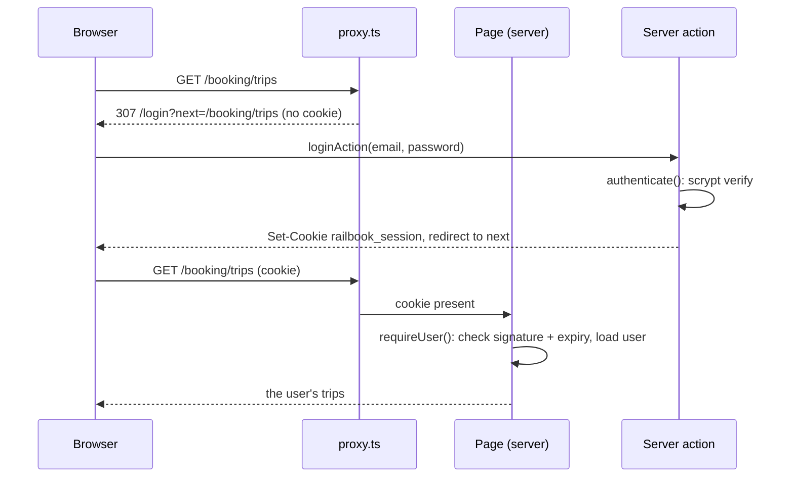

# 09 - Authentication

RailBook has two separate logins:

| | Passengers | Admins |
| --- | --- | --- |
| Pages | `/login`, `/register` | `/admin/login` |
| Cookie | `railbook_session` (30 days) | `railbook_admin` (8 hours) |
| Code | `src/lib/userAuth.ts` | `src/lib/adminAuth.ts` |
| Accounts | `src/data/users.ts` (sign up in the app) | `ADMIN_EMAIL` / `ADMIN_PASSWORD` env vars |
| Demo | `abhishek.pal@example.com` / `railbook123` | `admin@railbook.in` / `admin123` |

Being signed in as one does not sign you in as the other.

## What needs a passenger login

| Public | Needs login |
| --- | --- |
| Home, train search, PNR status, live status, schedules, the chat (except booking) | Passenger details, payment summary, tickets, My Trips, dashboard, profile, booking in chat |

A signed-out visitor who clicks "Book" goes to `/login?next=<the page they wanted>`. After logging in or
registering they land back on that page with their train and class still selected.

## Flow

## Pieces

| File | Does |
| --- | --- |
| `src/lib/password.ts` | `hashPassword()` (scrypt, random salt, stored as `scrypt$salt$hash`) and `verifyPassword()` (constant-time compare) |
| `src/data/users.ts` | The user store, `authenticate()`, `createUser()` with validation, `getUser()`. Never returns the password hash |
| `src/lib/userAuth.ts` | `createUserSession()`, `clearUserSession()`, `getCurrentUser()`, `requireUser(next)`, `safeNext()` |
| `src/app/(routes)/(auth)/actions.ts` | `loginAction`, `registerAction`, `logoutAction` server actions |
| `src/app/(routes)/(auth)/login`, `register` | The pages. A signed-in visitor is redirected away |
| `src/components/auth/` | `LoginForm` and `RegisterForm` (client, `useActionState`) |
| `src/proxy.ts` | Redirects signed-out visitors before the page renders |
| `src/components/layout/Navbar.tsx` | Log in / Sign up when signed out. Avatar and Log out when signed in. Both also in the mobile menu |
| `src/app/api/auth/*` | The same login, register, logout and "me" as JSON endpoints (chapter 11) |

## The session cookie

`railbook_session` = `<userId>.<expiresAt>.<HMAC-SHA256 signature>`

- It is signed with `USER_SESSION_SECRET`. Changing the secret logs everyone out.
- It is `httpOnly`, so JavaScript cannot read it, and `SameSite=Lax`, so other sites cannot send it in a
  form post. It is `Secure` in production and lasts 30 days.
- The proxy only checks that the cookie exists, which makes redirects fast. Every protected page and every
  booking action calls `getCurrentUser()` / `requireUser()`, which checks the signature and expiry and
  loads the user. A forged or expired cookie gets the login page, not data.
- Logging out deletes the cookie. Sessions are stateless, so there is no server-side list to revoke. If
  you need "log out everywhere", add a `sessionVersion` to the user and include it in the signed payload.

## Rules worth knowing

- **Open redirects.** `next` is only followed when it is a same-site path (`safeNext()` rejects `//evil.com`
  and full URLs).
- **Account enumeration.** A wrong email and a wrong password give the same message, and login hashes a
  password even when the email is unknown, so timing does not reveal which emails exist.
- **Ownership.** Bookings carry a `userId`. Tickets and `/booking/[id]` return 404 for other users, and My
  Trips and the dashboard only list your own bookings.
- **Saved passengers.** Registration adds you as your first saved passenger (that is why it asks for age and
  gender). Chat bookings use saved passengers in order.

## Making it production-ready

1. **Store users in PostgreSQL.** The `users` table exists in `src/db/schema/users.ts`. Replace the bodies of
   `getUser`, `authenticate` and `createUser` (chapter 12). Keep `password_hash` in the scrypt format, or
   switch both helpers in `password.ts` to argon2 or bcrypt together.
2. **Set `USER_SESSION_SECRET`** to a long random value (`openssl rand -base64 48`).
3. **Add rate limiting** to login and register, for example 5 attempts per minute per IP and email, using
   Redis, which is already a dependency.
4. **Add email verification and password reset.** Send a signed, short-lived token by email. Neither exists
   yet.
5. **Social login.** If you want Google or OTP login, Auth.js (`next-auth`) can replace `userAuth.ts`. Keep
   `getCurrentUser()` and `requireUser()` as thin wrappers so pages do not change.
